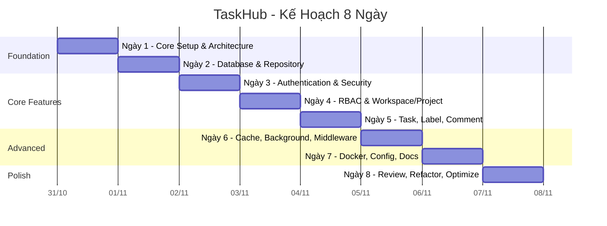

# 📘 Giải Thích Đề Bài & Kế Hoạch Làm Việc Chi Tiết

## Phần 1: Đề Bài Nói Gì? (Giải thích dễ hiểu)

### 🎯 Tổng quan một câu
> Bạn được yêu cầu **xây dựng một API quản lý công việc (giống Trello/Jira đơn giản)** bằng **FastAPI** trong **8 ngày** (mỗi ngày 8 tiếng).

### 🏗️ Sản phẩm cuối cùng: **TaskHub**
TaskHub là một **REST API backend** (không có giao diện frontend) cho phép:

| Ai dùng? | Làm gì? |
|---|---|
| **Admin** | Quản lý toàn bộ hệ thống, user |
| **Owner** (chủ workspace) | Tạo workspace, mời người, tạo project |
| **Editor** | Tạo/sửa task, comment, gán label |
| **Viewer** | Chỉ xem, không sửa |

### 🧩 Hệ thống gồm những gì?

Hãy tưởng tượng như thế này:

```
👤 User (người dùng)
  └── 📂 Workspace (không gian làm việc - VD: "Công ty ABC")
        ├── 👥 Members (thành viên được mời vào)
        └── 📁 Project (dự án - VD: "Website redesign")
              ├── 📝 Task (công việc - VD: "Thiết kế trang chủ")
              │     ├── 🏷️ Labels (nhãn - VD: "urgent", "bug")
              │     └── 💬 Comments (bình luận)
              └── 📝 Task khác...
```

### 📊 Bảng tóm tắt các tính năng bắt buộc

| # | Tính năng | Ý nghĩa đơn giản |
|---|---|---|
| 1 | **Auth** | Đăng ký, đăng nhập (JWT token), đăng xuất |
| 2 | **User** | Xem/sửa thông tin cá nhân, đổi mật khẩu |
| 3 | **Workspace** | Tạo/sửa/xóa workspace, mời/xóa thành viên |
| 4 | **Project** | Tạo/sửa/xóa project trong workspace |
| 5 | **Task** | Tạo/sửa/xóa task, gán người, đổi trạng thái, đặt ưu tiên |
| 6 | **Label** | Tạo nhãn, gắn/bỏ nhãn cho task |
| 7 | **Comment** | Thêm/xóa bình luận trên task |
| 8 | **Filter & Pagination** | Lọc task theo status/priority/assignee, phân trang |
| 9 | **Caching (Redis)** | Cache danh sách task để API nhanh hơn |
| 10 | **Background Task** | Gửi email khi được gán task (chạy ngầm) |
| 11 | **RBAC** | Phân quyền: ai được làm gì (Admin/Owner/Editor/Viewer) |
| 12 | **API Docs** | Swagger/ReDoc tự động, có auth, document lỗi |
| 13 | **Docker** | `docker compose up` chạy được toàn bộ (app + DB + Redis) |
| 14 | **Code quality** | Ruff lint pass 100%, mypy không lỗi |

### 🛠️ Tech stack (công nghệ sử dụng)

| Công nghệ | Vai trò |
|---|---|
| **FastAPI** | Framework API chính |
| **SQLAlchemy 2.x (async)** | ORM kết nối database |
| **Alembic** | Quản lý migration database |
| **Pydantic v2** | Validate dữ liệu request/response |
| **Redis** | Cache + token blacklist |
| **MySQL 8 / PostgreSQL 16** | Database chính |
| **Docker** | Container hóa ứng dụng |
| **Ruff** | Lint code Python |
| **mypy** | Kiểm tra type |

### ✅ Tiêu chí đánh giá
- Hoàn thành **≥ 85% features bắt buộc** (tối thiểu features 1–8 + 11–12)
- API chạy ổn định qua **Swagger UI / ReDoc**
- Nắm rõ các quyết định thiết kế: DB schema, phân quyền, cache strategy

---

## Phần 2: Kế Hoạch Làm Việc Chi Tiết 8 Ngày

---

### 📅 Ngày 1: Core Setup & Architecture (Nền móng)
**Mục tiêu:** Có một skeleton app chạy được với CRUD endpoints cơ bản cho 1 resource (User).

#### 🎓 Kiến thức cần học (1-2h)
- [ ] FastAPI là gì? So sánh với Flask/Django
- [ ] Layered Architecture (Controller → Service → Repository → Model)
- [ ] Dependency Injection trong FastAPI
- [ ] Pydantic v2: BaseModel, Field, validator

#### 🔨 Việc cần làm step-by-step

**Bước 1: Tạo cấu trúc thư mục project (30 phút)**
```
taskhub/
├── app/
│   ├── __init__.py
│   ├── main.py              # FastAPI app instance, lifespan
│   ├── core/
│   │   ├── __init__.py
│   │   ├── config.py         # Settings (pydantic-settings)
│   │   └── dependencies.py   # Shared dependencies
│   ├── api/
│   │   ├── __init__.py
│   │   └── v1/
│   │       ├── __init__.py
│   │       ├── router.py     # Include tất cả routers
│   │       └── endpoints/
│   │           ├── __init__.py
│   │           └── users.py   # User endpoints
│   ├── models/
│   │   ├── __init__.py
│   │   └── user.py
│   ├── schemas/
│   │   ├── __init__.py
│   │   └── user.py            # Pydantic schemas
│   ├── services/
│   │   ├── __init__.py
│   │   └── user.py
│   └── repositories/
│       ├── __init__.py
│       └── user.py
├── requirements.txt
├── .env
└── README.md
```

**Bước 2: Cài đặt dependencies (15 phút)**
```bash
pip install fastapi uvicorn[standard] pydantic pydantic-settings python-dotenv
```

**Bước 3: Viết `app/main.py` (30 phút)**
- Tạo FastAPI app instance
- Cấu hình lifespan events (startup/shutdown)
- Include router

**Bước 4: Viết config (30 phút)**
- `app/core/config.py`: Dùng `pydantic-settings` đọc `.env`

**Bước 5: Viết User schemas (45 phút)**
- `app/schemas/user.py`: `UserCreate`, `UserResponse`, `UserUpdate`

**Bước 6: Viết User endpoints tạm (in-memory) (1h)**
- `app/api/v1/endpoints/users.py`: CRUD cơ bản dùng list tạm
- GET, POST, PATCH, DELETE

**Bước 7: Test thử (30 phút)**
```bash
uvicorn app.main:app --reload
# Mở http://localhost:8000/docs để test Swagger UI
```

#### 📦 Thành quả cuối ngày 1
- [x] Project chạy được với `uvicorn`
- [x] Swagger UI hoạt động tại `/docs`
- [x] CRUD endpoints cho User (tạm dùng in-memory)
- [x] Cấu trúc thư mục Layered Architecture rõ ràng
- [x] Pydantic schemas validate input/output

---

### 📅 Ngày 2: Database — SQLAlchemy 2.x & Alembic
**Mục tiêu:** Kết nối database thật, tạo models, migrations, và CRUD thật qua Repository Pattern.

#### 🎓 Kiến thức cần học (1-2h)
- [ ] SQLAlchemy 2.x async: `AsyncSession`, `create_async_engine`
- [ ] Declarative Base, mapped_column, relationship
- [ ] Repository Pattern: BaseRepository[T]
- [ ] Alembic: init, autogenerate, upgrade/downgrade

#### 🔨 Việc cần làm step-by-step

**Bước 1: Cài thêm dependencies (15 phút)**
```bash
pip install sqlalchemy[asyncio] asyncmy alembic  # asyncmy cho MySQL
# hoặc: pip install asyncpg   # cho PostgreSQL
```

**Bước 2: Setup database connection (45 phút)**
- `app/core/database.py`: Tạo `async_engine`, `async_session_maker`
- `app/core/dependencies.py`: Tạo `get_db` dependency

**Bước 3: Tạo SQLAlchemy Models (1.5h)**
- `app/models/base.py`: Base class chung (id, created_at)
- `app/models/user.py`: User model với đầy đủ fields
- `app/models/workspace.py`: Workspace + WorkspaceMember
- `app/models/project.py`: Project model
- `app/models/task.py`: Task model
- `app/models/label.py`: Label + TaskLabel
- `app/models/comment.py`: Comment model

> [!TIP]
> Tạo hết models ngay từ đầu để Alembic generate migration một lần. Chưa cần viết CRUD cho tất cả.

**Bước 4: Setup Alembic (30 phút)**
```bash
alembic init alembic
```
- Sửa `alembic/env.py` để dùng async engine
- Sửa `alembic.ini` để đọc DB URL từ `.env`

**Bước 5: Tạo migration đầu tiên (15 phút)**
```bash
alembic revision --autogenerate -m "create all tables"
alembic upgrade head
```

**Bước 6: Viết BaseRepository (1.5h)**
- `app/repositories/base.py`: Generic CRUD (create, get_by_id, get_all, update, delete)
- `app/repositories/user.py`: UserRepository kế thừa BaseRepository

**Bước 7: Kết nối Repository → Service → Endpoint (1.5h)**
- Cập nhật `app/services/user.py`: dùng UserRepository
- Cập nhật `app/api/v1/endpoints/users.py`: inject DB session
- Xóa code in-memory cũ

**Bước 8: Test với database thật (30 phút)**
- Tạo user qua Swagger → kiểm tra database
- Test CRUD đầy đủ

#### 📦 Thành quả cuối ngày 2
- [x] Database kết nối OK (MySQL hoặc PostgreSQL)
- [x] Tất cả 8 bảng được tạo qua Alembic migration
- [x] BaseRepository[T] generic hoạt động
- [x] User CRUD chạy thật với database
- [x] Relationships giữa các models đúng

---

### 📅 Ngày 3: Authentication & Security
**Mục tiêu:** Hoàn thành toàn bộ hệ thống auth: register, login, refresh token, logout.

#### 🎓 Kiến thức cần học (1h)
- [ ] JWT (JSON Web Token): access token vs refresh token
- [ ] Password hashing: bcrypt
- [ ] OAuth2 scheme trong FastAPI
- [ ] Token blacklist với Redis

#### 🔨 Việc cần làm step-by-step

**Bước 1: Cài dependencies (10 phút)**
```bash
pip install passlib[bcrypt] python-jose[cryptography] redis
```

**Bước 2: Setup Redis connection (30 phút)**
- `app/core/redis.py`: Kết nối Redis
- Thêm Redis config vào `app/core/config.py`

**Bước 3: Viết security utilities (1h)**
- `app/core/security.py`:
  - `hash_password(plain)` → hashed
  - `verify_password(plain, hashed)` → bool
  - `create_access_token(data)` → JWT string
  - `create_refresh_token(data)` → JWT string
  - `decode_token(token)` → payload

**Bước 4: Viết Auth schemas (30 phút)**
- `app/schemas/auth.py`: `LoginRequest`, `TokenResponse`, `RegisterRequest`

**Bước 5: Viết Auth service (1.5h)**
- `app/services/auth.py`:
  - `register(data)`: tạo user mới, hash password
  - `login(email, password)`: verify, tạo token pair
  - `refresh(refresh_token)`: tạo access token mới
  - `logout(token)`: blacklist refresh token vào Redis

**Bước 6: Viết Auth endpoints (1h)**
- `app/api/v1/endpoints/auth.py`:
  - `POST /api/v1/auth/register`
  - `POST /api/v1/auth/login`
  - `POST /api/v1/auth/refresh`
  - `POST /api/v1/auth/logout`

**Bước 7: Viết `get_current_user` dependency (45 phút)**
- `app/core/dependencies.py`: Đọc JWT từ header → trả về User

**Bước 8: Bảo vệ User endpoints (30 phút)**
- `GET /api/v1/users/me` → cần token
- `PATCH /api/v1/users/me` → cần token
- Test đăng ký → đăng nhập → gọi API với token

**Bước 9: Test toàn bộ flow (45 phút)**
1. Register → nhận thông báo thành công
2. Login → nhận access + refresh token
3. Gọi `/users/me` với token → thấy profile
4. Refresh → nhận token mới
5. Logout → token cũ không dùng được

#### 📦 Thành quả cuối ngày 3
- [x] Register/Login/Refresh/Logout hoạt động
- [x] JWT access + refresh token
- [x] Password hashed bằng bcrypt
- [x] Redis chạy (dùng cho token blacklist)
- [x] `get_current_user` dependency hoạt động
- [x] Swagger UI có nút "Authorize" (Bearer token)

---

### 📅 Ngày 4: RBAC & Workspace/Project CRUD
**Mục tiêu:** Phân quyền hoàn chỉnh + CRUD cho Workspace và Project.

#### 🎓 Kiến thức cần học (1h)
- [ ] RBAC (Role-Based Access Control)
- [ ] Quyền theo resource: ownership check
- [ ] FastAPI dependencies lồng nhau (dependency chain)

#### 🔨 Việc cần làm step-by-step

**Bước 1: Thiết kế ma trận phân quyền (30 phút)**

| Action | ADMIN | OWNER | EDITOR | VIEWER |
|---|---|---|---|---|
| Tạo workspace | ✅ | ✅ | ❌ | ❌ |
| Xóa workspace | ✅ | ✅ (of own) | ❌ | ❌ |
| Mời member | ✅ | ✅ | ❌ | ❌ |
| Tạo project | ✅ | ✅ | ✅ | ❌ |
| CRUD task | ✅ | ✅ | ✅ | ❌ |
| Xem task | ✅ | ✅ | ✅ | ✅ |

**Bước 2: Viết RBAC dependencies (1.5h)**
- `app/core/permissions.py`:
  - `require_role(min_role)` → dependency
  - `require_workspace_role(min_role)` → check role trong workspace
  - `require_admin()` → shortcut

**Bước 3: Workspace CRUD (2h)**
- `app/repositories/workspace.py`
- `app/services/workspace.py`
- `app/api/v1/endpoints/workspaces.py`:
  - `POST /api/v1/workspaces` → tạo workspace (user thành OWNER)
  - `GET /api/v1/workspaces/{id}` → xem chi tiết
  - `PUT /api/v1/workspaces/{id}` → sửa (owner only)
  - `DELETE /api/v1/workspaces/{id}` → xóa (owner only)
  - `POST /api/v1/workspaces/{id}/members` → mời member
  - `DELETE /api/v1/workspaces/{id}/members/{user_id}` → xóa member

**Bước 4: Project CRUD (2h)**
- `app/repositories/project.py`
- `app/services/project.py`
- `app/api/v1/endpoints/projects.py`:
  - `POST /api/v1/workspaces/{id}/projects` → tạo project
  - `GET /api/v1/projects/{id}` → xem
  - `PATCH /api/v1/projects/{id}` → sửa
  - `PATCH /api/v1/projects/{id}/archive` → archive

**Bước 5: Test phân quyền (1h)**
- User A tạo workspace → mời User B là VIEWER
- User B thử tạo task → bị từ chối (403)
- Test tất cả combinations

#### 📦 Thành quả cuối ngày 4
- [x] RBAC hoạt động đúng (ADMIN/OWNER/EDITOR/VIEWER)
- [x] Workspace CRUD + quản lý member
- [x] Project CRUD + archive
- [x] Phân quyền check ở mọi endpoint

---

### 📅 Ngày 5: Task, Label, Comment CRUD
**Mục tiêu:** Hoàn thành CRUD cho Task (trọng tâm), Label, Comment + Filter & Pagination.

#### 🔨 Việc cần làm step-by-step

**Bước 1: Task CRUD (3h)**
- `app/repositories/task.py`
- `app/services/task.py`
- `app/api/v1/endpoints/tasks.py`:
  - `POST /api/v1/projects/{id}/tasks` → tạo task
  - `GET /api/v1/projects/{id}/tasks` → list tasks (có filter + pagination)
  - `PATCH /api/v1/tasks/{id}` → sửa (status, priority, assignee, due_date)
  - `DELETE /api/v1/tasks/{id}` → xóa

**Bước 2: Filter & Pagination (1.5h)**
- Query params: `?status=TODO&priority=HIGH&assignee_id=1&page=1&limit=20`
- `app/schemas/common.py`: `PaginationParams`, `PaginatedResponse[T]`
- Repository: build dynamic query

**Bước 3: Label CRUD (1.5h)**
- `app/api/v1/endpoints/labels.py`:
  - CRUD cho labels (per project)
  - `POST /api/v1/tasks/{id}/labels/{label_id}` → gán label
  - `DELETE /api/v1/tasks/{id}/labels/{label_id}` → bỏ label

**Bước 4: Comment CRUD (1h)**
- `app/api/v1/endpoints/comments.py`:
  - `POST /api/v1/tasks/{id}/comments` → thêm comment
  - `GET /api/v1/tasks/{id}/comments` → list comments
  - `DELETE /api/v1/comments/{id}` → xóa (author only)

**Bước 5: Test toàn bộ flow nghiệp vụ (1h)**
1. Tạo workspace → tạo project → tạo task
2. Gán task cho member → đổi status → set priority
3. Tạo label → gán vào task
4. Comment trên task
5. Filter tasks theo status + pagination

#### 📦 Thành quả cuối ngày 5
- [x] Task CRUD hoàn chỉnh với assign, status, priority
- [x] Filter & Pagination hoạt động
- [x] Label gán/bỏ cho task
- [x] Comment trên task
- [x] Flow nghiệp vụ end-to-end chạy OK

---

### 📅 Ngày 6: Caching, Background Tasks & Middleware
**Mục tiêu:** Thêm Redis cache, background email, middleware xử lý lỗi, logging.

#### 🔨 Việc cần làm step-by-step

**Bước 1: Redis Caching (2h)**
- Cache `GET /projects/{id}/tasks` vào Redis
- Key pattern: `tasks:project:{project_id}:page:{page}:...`
- TTL: 5 phút
- **Invalidation**: Khi tạo/sửa/xóa task → xóa cache của project đó
- `app/core/cache.py`: helper functions `get_cache`, `set_cache`, `invalidate_cache`

**Bước 2: Background Tasks (1.5h)**
- `app/services/notification.py`:
  - Khi assign task → gửi email notification (dùng FastAPI `BackgroundTasks`)
  - Tạm thời log ra console thay vì gửi email thật (hoặc dùng mailtrap)

**Bước 3: Middleware & Exception Handling (2h)**
- `app/core/middleware.py`:
  - Request logging middleware (log method, path, duration)
  - CORS middleware
- `app/core/exceptions.py`:
  - Custom exceptions: `NotFoundException`, `ForbiddenException`, `BadRequestException`
  - Global exception handler → trả JSON format thống nhất

**Bước 4: Logging (1.5h)**
- `app/core/logging.py`: Setup structured logging
- Dùng `logging` module hoặc `loguru`
- Log format: `[timestamp] [level] [module] message`

**Bước 5: Test (1h)**
- Gọi GET tasks → response nhanh (cached)
- Sửa task → gọi lại → data mới (cache invalidated)
- Assign task → check log thấy "notification sent"
- Gọi endpoint sai → nhận error JSON đẹp

#### 📦 Thành quả cuối ngày 6
- [x] Redis cache hoạt động + invalidation đúng
- [x] Background task gửi notification khi assign
- [x] Custom exceptions + global error handler
- [x] Request logging middleware
- [x] CORS middleware

---

### 📅 Ngày 7: Docker, Configuration & API Documentation
**Mục tiêu:** Container hóa toàn bộ stack, hoàn thiện config và docs.

#### 🔨 Việc cần làm step-by-step

**Bước 1: Dockerfile (1.5h)**
```dockerfile
# Multi-stage build
FROM python:3.12-slim AS builder
# ... install dependencies

FROM python:3.12-slim AS runner
# ... copy from builder, run app
```

**Bước 2: docker-compose.yml (1.5h)**
```yaml
services:
  app:        # FastAPI app
  db:         # MySQL/PostgreSQL
  redis:      # Redis
```
- Test: `docker compose up` → mọi thứ chạy

**Bước 3: Configuration hoàn thiện (1h)**
- `app/core/config.py`: Dùng `pydantic-settings`
- `.env.example`: Template cho người khác
- Fail-fast: app crash ngay nếu thiếu env vars quan trọng
- Multi-environment: dev / staging / production

**Bước 4: API Documentation (2h)**
- Thêm docstrings cho tất cả endpoints
- Thêm `response_model`, `status_code`, `summary`, `description`
- Thêm error responses: 401, 403, 404, 422
- Bearer auth scheme trong Swagger
- Kiểm tra Swagger UI + ReDoc đẹp và đầy đủ

**Bước 5: Change password endpoint (1h)**
- `PATCH /api/v1/users/me/password`
- Yêu cầu: current_password + new_password

**Bước 6: Test Docker (1h)**
```bash
docker compose up --build
# Mở http://localhost:8000/docs
# Test vài endpoints
```

#### 📦 Thành quả cuối ngày 7
- [x] `docker compose up` chạy toàn bộ stack
- [x] Dockerfile multi-stage build
- [x] `.env.example` đầy đủ
- [x] Swagger/ReDoc documentation hoàn chỉnh
- [x] Change password hoạt động

---

### 📅 Ngày 8: Review, Refactor & Optimization
**Mục tiêu:** Code sạch, lint pass, mypy pass, README hoàn chỉnh, hệ thống ổn định.

#### 🔨 Việc cần làm step-by-step

**Bước 1: Ruff lint (1.5h)**
```bash
pip install ruff
ruff check . --fix          # Auto-fix được
ruff check .                # Kiểm tra lại → phải 0 errors
ruff format .               # Format code
```
- Tạo `ruff.toml` hoặc `pyproject.toml` section `[tool.ruff]`

**Bước 2: mypy check (1.5h)**
```bash
pip install mypy
mypy app/ --ignore-missing-imports
```
- Fix tất cả type errors
- Thêm type hints cho functions thiếu

**Bước 3: Code review bản thân (2h)**
Checklist:
- [ ] Không có code trùng lặp (DRY)
- [ ] Naming conventions nhất quán (snake_case)
- [ ] Không có hardcoded values → dùng config/constants
- [ ] Tất cả endpoints có proper error handling
- [ ] Không có `print()` → dùng `logging`
- [ ] Không có secrets trong code → dùng `.env`
- [ ] Không có unused imports

**Bước 4: Performance review (1h)**
- [ ] Database queries có N+1 problem không?
- [ ] Dùng `selectinload` / `joinedload` cho relationships
- [ ] Redis cache đang hoạt động đúng?
- [ ] Index cho các columns hay query (email, status, ...)

**Bước 5: Viết README.md (1.5h)**
```markdown
# TaskHub - Task Management API

## Overview
## Tech Stack
## Quick Start
### Prerequisites
### Setup with Docker
### Setup without Docker
## Environment Variables
## API Documentation
## Project Structure
## Database Schema (ER diagram)
```

**Bước 6: Test end-to-end lần cuối (30 phút)**
1. `docker compose up` → chạy OK
2. Register → Login → tạo workspace → mời member
3. Tạo project → tạo tasks → filter → assign
4. Gán label → comment → check cache
5. Test phân quyền: viewer không tạo được task

#### 📦 Thành quả cuối ngày 8
- [x] `ruff check .` → 0 errors
- [x] `mypy app/` → 0 errors
- [x] Code sạch, không trùng lặp
- [x] README.md hoàn chỉnh
- [x] Toàn bộ hệ thống chạy ổn định qua Docker
- [x] Flow end-to-end không lỗi

---

## Phần 3: Tóm Tắt Timeline



## Phần 4: Checklist Tổng Hợp (Đánh Giá Cuối Cùng)

| # | Feature | Ngày hoàn thành | Status |
|---|---|---|---|
| 1 | Auth (Register/Login/Refresh/Logout) | Ngày 3 | ⬜ |
| 2 | User (Profile, Update, Change password) | Ngày 3 + 7 | ⬜ |
| 3 | Workspace CRUD + Members | Ngày 4 | ⬜ |
| 4 | Project CRUD + Archive | Ngày 4 | ⬜ |
| 5 | Task CRUD + Assign + Status + Priority | Ngày 5 | ⬜ |
| 6 | Label CRUD + Gán/bỏ label | Ngày 5 | ⬜ |
| 7 | Comment CRUD | Ngày 5 | ⬜ |
| 8 | Filter & Pagination | Ngày 5 | ⬜ |
| 9 | Redis Cache + Invalidation | Ngày 6 | ⬜ |
| 10 | Background Task (Notification) | Ngày 6 | ⬜ |
| 11 | RBAC (Admin/Owner/Editor/Viewer) | Ngày 4 | ⬜ |
| 12 | Swagger/ReDoc Documentation | Ngày 7 | ⬜ |
| 13 | Docker Compose | Ngày 7 | ⬜ |
| 14 | Ruff + mypy pass | Ngày 8 | ⬜ |

> [!IMPORTANT]
> **Tối thiểu cần hoàn thành features 1–8 + 11–12** (≥ 85%) để đạt yêu cầu.
> Features 9, 10, 13, 14 là điểm cộng nhưng nên cố gắng hoàn thành hết.

> [!TIP]
> **Mẹo:** Sau mỗi ngày, commit code lên Git với message rõ ràng. VD: `feat: add auth with JWT tokens (Day 3)`. Điều này giúp track tiến độ và rollback nếu cần.
